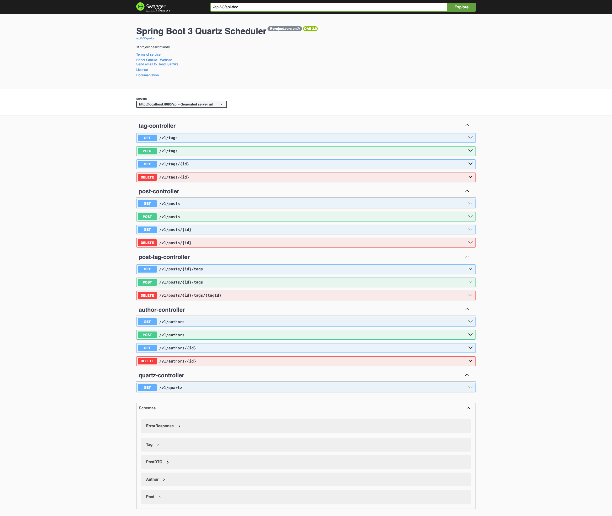

# Spring Boot 4 Quartz Sample

[](https://github.com/hendisantika/spring-boot-quartz-sample/actions/workflows/gradle.yml)


Sample REST API that schedules jobs with **Quartz Scheduler** (JDBC job store on MySQL), built with
**Spring Boot 4** and **JDK 25**.

## Tech Stack

| Category       | Technology                                                       |
|----------------|------------------------------------------------------------------|
| Language       | Java 25 (Gradle toolchain)                                       |
| Framework      | Spring Boot 4.1 (Web MVC, Data JPA, Validation, Actuator, Mail)  |
| Scheduler      | Quartz (`spring-boot-starter-quartz`, JDBC job store)            |
| Database       | MySQL 9 + Flyway migrations                                      |
| API Docs       | springdoc-openapi (Swagger UI)                                   |
| Build          | Gradle 9 (wrapper)                                               |
| Testing        | JUnit 5, Testcontainers 2 (MySQL), REST Assured                  |
| CI/CD          | GitHub Actions + Dependabot                                      |

## Prerequisites

- JDK 25 (or let the Gradle toolchain provision it)
- Docker (for MySQL via Docker Compose and for Testcontainers tests)

## Getting Started

1. Clone this repository:
   ```shell
   git clone https://github.com/hendisantika/spring-boot-quartz-sample.git
   ```
2. Navigate to the folder:
   ```shell
   cd spring-boot-quartz-sample
   ```
3. Run the application (MySQL from `compose.yaml` is started automatically by
   `spring-boot-docker-compose`):
   ```shell
   ./gradlew bootRun
   ```
4. Open Swagger UI: http://localhost:8080/api/swagger-ui



## Build & Test

```shell
# Compile, run tests (needs Docker for Testcontainers) and build the jar
./gradlew clean build

# Run tests only
./gradlew test

# Show application info
./gradlew printInfo
```

The executable jar is generated in `build/libs/`.

## MySQL

MySQL is defined in [`compose.yaml`](compose.yaml) (exposed on port `13306`). To run it manually:

```shell
docker run --name mysql -p 13306:3306 -e MYSQL_ROOT_PASSWORD=root -d mysql:9.1.0
docker exec -it mysql bash
docker logs mysql
```

- Application tables are created by Flyway (`src/main/resources/db/migration`).
- Quartz tables (`QRTZ_*`) are created from `src/main/resources/quartz/quartz.sql`
  (`spring.quartz.jdbc.initialize-schema=always`). Table names are upper case to match
  `org.quartz.jobStore.tablePrefix=QRTZ_`, which matters on case-sensitive MySQL (Linux).

## Continuous Integration

The [`Java CI with Gradle`](.github/workflows/gradle.yml) workflow runs on every push / pull request to `main`:

- **build** – sets up JDK 25 (Temurin) and runs `./gradlew build`. Integration tests use Testcontainers on the
  Docker engine of the GitHub-hosted runner. Test reports are uploaded as an artifact when the build fails.
- **dependency-submission** – on push to `main`, submits the Gradle dependency graph so Dependabot alerts cover
  all project dependencies.

## Dependabot

[`.github/dependabot.yml`](.github/dependabot.yml) keeps dependencies up to date:

| Ecosystem       | Schedule (Asia/Jakarta) | Grouping                                                                 |
|-----------------|-------------------------|--------------------------------------------------------------------------|
| Gradle          | Daily 05:00             | `spring-boot`, `testcontainers`, `test-libraries`, `gradle-minor-patch`  |
| GitHub Actions  | Weekly (Mon) 05:00      | `github-actions` (all actions in a single PR)                            |
| Docker Compose  | Weekly (Mon) 05:00      | –                                                                        |

PRs are labeled (`dependencies`, `java`, `github_actions`, `docker`) and use conventional commit prefixes
(`chore(deps)`, `ci(deps)`, `chore(docker)`).

## References

- https://hub.docker.com/_/mysql
- https://github.com/quartznet/quartznet/blob/main/database/tables/tables_mysql_innodb.sql
- https://www.quartz-scheduler.org/documentation/
- https://docs.spring.io/spring-boot/reference/io/quartz.html

## Other

1. Google Java Format
2. SonarLint
3. CheckStyle-IDEA
4. GitHub Copilot
5. Disable import * (Settings -> Editor -> Code Style -> Java -> Imports)
